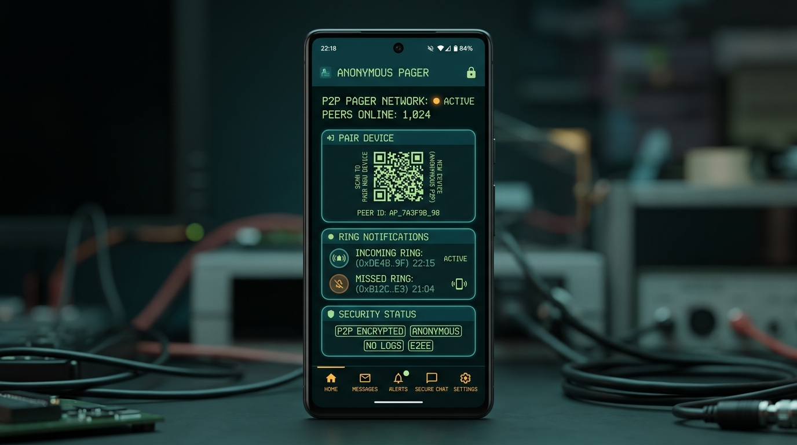

# 📟 Wen · وين

> **Privacy-First Peer Alerting System**: No names, no phone numbers, no contact books, no identity leakage.

---



---

## 🔒 What is Anonymous Pager?

**Wen** (وين, formerly Anonymous Pager) is a native Android application built with **Kotlin** and **Jetpack Compose**. It allows two individuals to establish a direct, anonymous signaling channel via temporary PINs or QR codes — enabling one user to "ring" or alert the other without exchanging any personal identifiable information (PII).

Think of it as a **digital physical pager**: secure, instant, zero-metadata, and strictly peer-scoped.

---

## 🛠️ Key Features

* 🚫 **Zero PII Exposure**: No account registration, phone numbers, or contact permission required.
* 📲 **QR & PIN Pairing**: Generate short-lived QR codes or PINs to pair devices in seconds.
* 🔔 **Super Ring Mode**: High-priority alert mechanism utilizing the Android alarm audio stream, bypasses standard media silencers with custom vibration sequences for emergency signals.
* 📟 **Retro LCD Aesthetic**: Custom Jetpack Compose UI styled after classic physical pagers with dark cyber-teal and amber neon accents.
* 🛡️ **Built-in Blocking**: Instant peer blocking and unblocking capabilities with client-side status labels.

---

## 🏗️ Project Architecture

The codebase is organized into client and backend modules:

```text
anonymous-pager/
├── app/                  # Native Android app (Kotlin + Jetpack Compose)
│   ├── src/main/java/    # UI Composables, ViewModels, & Firestore Listeners
│   └── res/              # Vector assets, themes, & notification channels
├── functions/            # Firebase Cloud Functions (Node.js / TypeScript)
│   └── src/              # Secure pair verification, rate-limiting & callable triggers
├── firestore.rules       # Granular database security & document access policies
└── firebase.json         # Firebase Emulator Suite setup & deployment config
```

---

## ⚙️ Tech Stack & Technologies

* **Language**: Kotlin 2.x
* **UI Toolkit**: Jetpack Compose + Material 3
* **Backend**: Firebase Firestore (Real-time listener architecture) + Cloud Functions
* **Camera / QR**: CameraX + ML Kit Barcode Scanning
* **Notifications**: Firebase Cloud Messaging (FCM) + Android Notification Manager

---

## 🚀 Quickstart & Local Development

### 1. Requirements
* **Android Studio**: Jellyfish / Koala or newer
* **JDK**: 17 or higher
* **Firebase Project**: Spark (free) or Blaze plan

### 2. Firebase setup
1. In the Firebase console, add an Android app with package name **`com.anas.wen`** and download its `google-services.json` into `app/`.
2. Enable **Authentication → Sign-in method → Anonymous**.
3. Deploy functions and rules (Blaze plan required): `firebase deploy --only functions,firestore`.

### 3. Running the Android Client
1. Clone this repository:
   ```bash
   git clone https://github.com/anasalghillani/anonymous-pager.git
   ```
2. Open the project root in **Android Studio**.
3. Let Gradle sync dependencies.
4. Run on an Android emulator or physical device (Android 8.0+ / API 26+).

### 4. Running Firebase Emulator Suite (Functions & Database)
```bash
cd functions
npm install
npm run build
firebase emulators:start
```

---

## 🔐 Deployment & Cloud Functions

To deploy updated Cloud Functions and Firestore rules to Firebase:

```bash
firebase deploy --only functions,firestore
```

> **Note**: The app signs in with Firebase Anonymous Auth and sends every write through Cloud Functions; Firestore rules only let a device read its own connections and rings. This requires the **Blaze plan**.

---

<p align="center">
  <i>Open source privacy experiment — Built with Kotlin & Jetpack Compose.</i>
</p>
